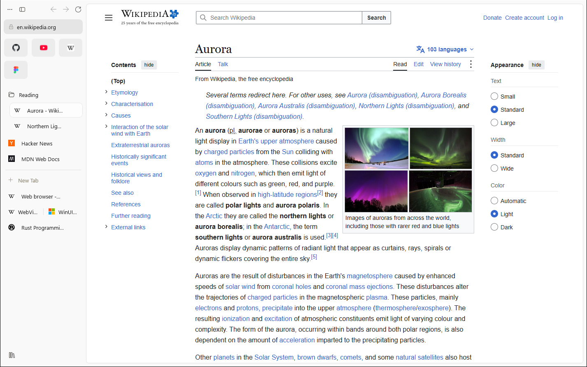
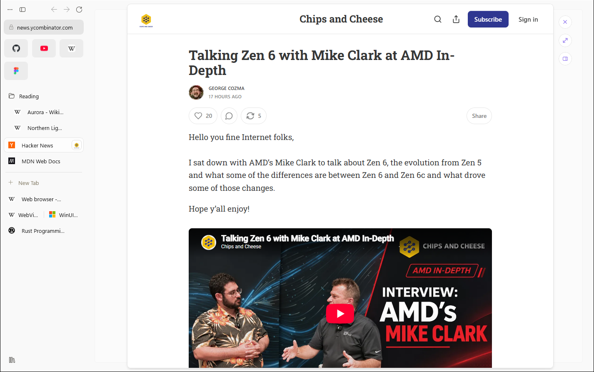
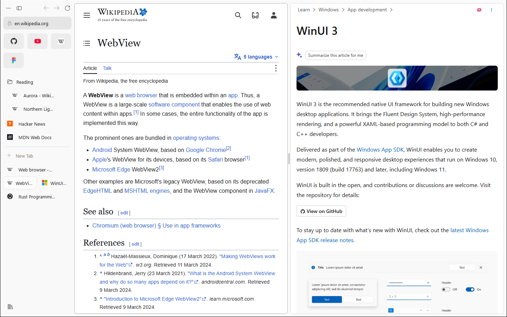
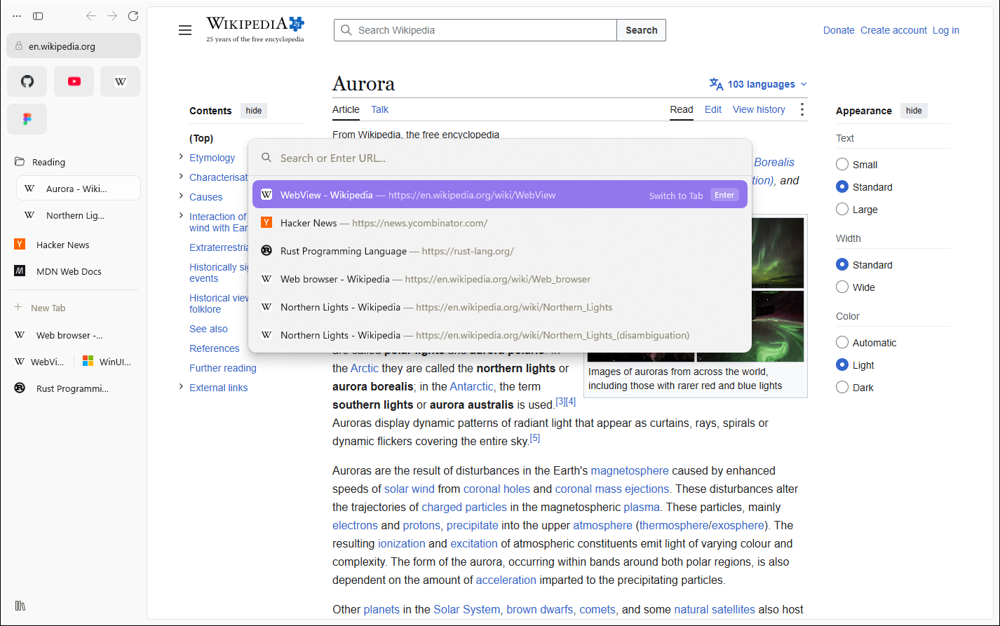

# Drift

A native Windows browser shell: WinUI 3 for the interface, WebView2 (Chromium) for pages.
Same split as Arc: an unmodified engine with your own UI on top.



| Peek | Split view | Command bar |
|---|---|---|
|  |  |  |

## What works

- Arc-style window: acrylic backdrop (the windows behind show through, blurred; Windows makes it
  solid while Drift isn't in front), no system title bar, the page inset as a card.
  Drag the window from the empty middle of the sidebar's top row or the margins around the page.
  Minimize, maximize and close are in the `⋯` menu (Alt+F4 also works).
- Sidebar like Zen's: **Essentials** (favicon tiles, up to four across, rows kept even, lined up with the
  address bar), then **folders**, then **pinned tabs** (rows with titles), then New Tab and the regular tabs. Essentials
  and pinned tabs belong to a page: links that leave its site open in Peek. A pinned tab's hover
  button is "−", which unloads it (frees the page and sends it back to its own page, dimmed);
  an unloaded pinned tab shows "×", which removes it. Drag tabs to reorder them (Essentials
  across rows and columns), or drag one into another group to pin, unpin, or add it to or remove
  it from Essentials; an empty group shows a place to drop while you drag. Over the tab lists, a
  line with a ring in your accent colour (like Zen's) shows where it will land; over Essentials,
  the tiles move into the order a drop would give, with the tab faded in its new spot. The tab
  under the pointer is a tile over Essentials and a row over the lists. Right-click works too.
- **Command bar**, like Arc's: Ctrl+T (or New Tab) opens a centred search field over the page for
  a new tab; Ctrl+L or a click on the address pill opens it on the current tab's URL. Empty, it
  offers a link on your clipboard ("Visit from clipboard", like Zen's), then your recent tabs. As you type it completes sites you've visited inline ("you" → youtube.com)
  and lists the search, Google's suggestions, matching open tabs ("Switch to Tab") and history.
  Up/Down, Enter, Esc; the highlighted row is in your Windows accent colour. Input can be URLs,
  bare domains, `localhost:4200`, or a search. It also runs commands, as in Arc: type part of
  one's name ("dev", "pin to read", "split") and it's offered, with the folder it's for in a chip
  and its shortcut. For the tab: copy link, close, duplicate, pin or unpin, add to Essentials, pin
  to a folder or a new one, reset a pinned tab or make its current page its own, reveal it in the
  sidebar. Reopen closed tab, clear tabs, new folder, open a folder. Split view: add one (the bar
  again, for a page or tab to open beside this one), separate, or expand the half you're on. The
  page: back, forward, reload, find, zoom in or out or back to actual size, print, save as,
  developer tools. New Google Doc, Sheet, Slides or Form, Notion page or Figma file. Show or hide
  the sidebar, private window, downloads, history, full screen, minimize, close window, settings,
  keyboard shortcuts, extensions (manage, or add from the Chrome Web Store), set as default browser.
- **Settings** (`⋯` menu, or Ctrl+,): the default browser and ad blocking; what happens to tabs
  when Drift closes (keep them all, or only pinned tabs) and what's in front when it opens (the
  last tab, a new tab, or a page); the keyboard shortcuts (click one, press the new keys);
  extensions; and privacy.
- **Library**, as in Zen: Downloads and History in the sidebar's place, twice its width, with a
  rail to switch between them and a search box. Open it with the button at the bottom left of the
  sidebar, Ctrl+J or Ctrl+H (the same key again closes it), ⋯ › Downloads or History, or by
  swiping sideways on the sidebar with two fingers: the sidebar widens under them and, let go,
  springs open or shut (a flick goes the way it was flicked). ← or Esc goes back to the tabs.
- **Picture-in-picture**, as in Arc: leave a tab with a video playing (with its sound on) and it
  floats in Chromium's own picture-in-picture window, over everything, with its controls. Come
  back to the tab and the video's back in the page, still playing; Back to tab in the window
  brings you back to it. A Google Meet call floats itself, in a small always-on-top window of
  Drift's. Neither window gets a taskbar button. Settings › Tabs turns it off.
- **Mini player**, as in Arc: a tab playing sound has a speaker on its row (on an Essential, a badge on
  its icon); click it to mute the tab, and again to unmute. At the bottom of the sidebar, a
  controller for the tab playing media (not a notification's chime: the site describes it, it's
  over 15 seconds or live, or it's played 10 seconds straight): its icon (click to go to it), skip
  back, play/pause, skip forward and mute. Skipping goes to the previous or next track where the site has them (as its
  media keys would), otherwise 10 seconds back or on. It stays while the tab plays, from any
  tab, and for five minutes after it's paused. Hover it and it grows into a card: the album
  cover or video thumbnail where the site gives one, the title (scrolling by when it's long), the artist or site, picture-in-picture, close, and a bar to seek with.
- **Downloads**, as in Arc and Zen, on the library button: when a download starts, its file's icon
  pops up where you clicked and curves into a badge at the button's top right, which shows the
  newest download's picture with a ring that fills with their progress (spinning while a size isn't
  known, greyed while they're all paused); once they're done the badge stays until you've hovered
  the button or opened the library, which then opens at Downloads. Hover the button and your three newest downloads rise above it, each with the
  file's own picture (an image, a PDF's first page, a video's frame; otherwise its type's icon) and
  when it finished, or its progress. Click one to open it, or drag it onto a page's upload box,
  Explorer or another app; right-click the button to choose which kinds of file (images, documents,
  archives…) show there. The library's list has progress and time left, pause and resume, cancel,
  open a file (click it), show it in its folder, remove it from the list, or drag it out; right-click
  one to copy its link or move the file itself to the Recycle Bin. Files go to your Downloads folder,
  or the one chosen in Settings › General › Downloads, where you also choose how long finished downloads stay
  in the list (a month at first; the files stay). The list is kept in `downloads.json`. WebView2
  doesn't always say when a download has finished, so once every byte is in, Drift also counts it
  done when the file is saved under its final name.
- **History**: every page you've visited, newest first, by day. Click a page to open it in a new
  tab. Hover a page and, as in Zen, it shows when you visited it, with buttons to remove it or
  reopen it. Filter (beside the search), as in Zen: visited today, this week or this month; by date,
  by site, by most visited or by last visited; history or closed tabs (reopened just as they were).
- **Privacy** (Settings › Privacy): clear browsing history, cookies and site data, cached files,
  the download list and saved passwords, for the last hour, day, week, 4 weeks or all time. Switch
  saving passwords and filling forms on or off (both on: Drift offers to save a password after you
  sign in). The sites you've allowed or blocked something for, with a button to reset each.
- **Microsoft sign-in**, as in Edge: Outlook, Office, SharePoint and other Microsoft sites sign in
  with the account you're signed in to Windows with (work or school, or a personal Microsoft
  account), without a sign-in page. Asked about the first time Drift runs; the first time it
  happens, a notice says so, with Use a different account and Turn off. Settings › Accounts shows
  your Windows account (name, email, picture), the switch (it applies when Drift restarts, with
  Restart now, which keeps every tab), Sign in with a different Microsoft account (Microsoft's
  account picker) and Sign out of Microsoft sites (their cookies and storage; open Microsoft tabs
  are unloaded, and you can turn automatic sign-in off at the same time). Private windows aren't
  signed in.
- **Address pill**, like Arc's: a padlock at the start on secure pages (a warning on plain `http`
  pages and on a site whose certificate was rejected that you went on to anyway); its tooltip says
  which. While the pointer is in the sidebar, copy link and site settings show at the end (taking
  no room otherwise). The padlock and the site settings button both open **site settings**: the
  site and whether its connection is secure; a switch to turn ad blocking off for just that site
  (some sites break with it on: Figma's sign-in never appears), which reloads the page; the
  site's camera, microphone, location and notification permissions (ask, allow or block) and any
  others it has; and "Clear cookies and site data" for just that site.
- **New Tab** shows its shortcut ("Ctrl T", or whatever it's set to) while hovered.
- **Reload** turns into a stop button (×) while the page is loading.
- **Private window** (Ctrl+Shift+N, or ⋯ › New private window): tinted violet with a "Private"
  badge. Its pages use a profile of their own that keeps cookies and storage only until the last
  private window closes; nothing goes into history, the session or the closed-tabs list, and no
  passwords or form data are saved. The ad blocker is on there too.
- **Crashed pages**: if a page's process dies, the tab says so ("This page crashed") with Reload.
  A page that hangs offers Wait or Reload. If the whole web engine stops, the tab in front says so
  and Reload starts a new engine; the other tabs are put back to sleep and load again when opened.
- **Default browser**: Settings › General › Make default registers Drift with Windows (for your
  account, no admin) and opens Default apps on Drift's page, where "Set default" makes it the
  browser. Only one Drift runs: links from other apps, or Drift started again, open as new tabs in
  the window that's already open. `Drift.exe https://example.com` works too.
- **Ad blocking**: uBlock Origin Lite, downloaded from its GitHub releases the first time Drift
  runs (on by default; Settings › General turns it off). Trackers and ad requests are blocked;
  some ad scripts are swapped for harmless stand-ins so pages don't break.
- **Extensions** (Settings › Extensions): add Chrome or Edge extensions from their unpacked
  folder, switch them on and off, remove them. They work in pages, but Drift has no toolbar, so
  their buttons and popups don't show.
- **PDFs**, as in Edge: Draw, Erase, Highlight and Add text, and Save writes them into the file.
  WebView2 ships Edge's viewer with these switched off, so Drift turns them on as each PDF opens.
  Closing a PDF with unsaved edits asks first. How it works, and what to check when a WebView2
  update breaks it: `docs/pdf-annotations.md`.
- **Spaces**, as in Arc: each Space has its own pinned tabs, tabs and folders, with Essentials
  shared by all. New Space is in the + menu; the Space's icons sit between the Library button and +
  at the foot of the sidebar (dots when there are too many, or for a Space with no icon), and its
  name is at the top of its tabs (double-click to rename). Go from Space to Space with a click,
  Ctrl+1–9, two fingers sideways over the tabs (right from the first Space opens the Library), or
  the mouse's back and forward buttons over the sidebar. Right-click a tab for Move to Space;
  right-click a Space's icon to rename it, change its icon or delete it.
- **Tabs from the keyboard**: Ctrl+Tab, as in Arc, works like Alt+Tab for tabs: a quick press goes
  back to the tab you were on last; hold Ctrl and a bar of your open tabs comes up, most recently used
  first, with a picture of each; Tab moves along (Ctrl+Shift+Tab back), and letting go of Ctrl goes
  to the one picked (Esc stays put). Settings › Tabs can have it go down the sidebar instead.
  Ctrl+1 to Ctrl+9 go to that Space. Ctrl+Shift+C copies the page's link. Ctrl+Shift+T (or
  ⋯ › Reopen closed tab) brings back the last tab closed, in its group and place; closed tabs are
  remembered across restarts.
- **Google Calendar**, as in Arc: pin calendar.google.com (Essentials, pinned tabs or a folder)
  and sign in there. Its tile counts down to your next meeting within the hour ("in 12m"), and the
  meeting shows at the foot of the sidebar, above the mini player: a row with its name and
  countdown that grows into a card on hover (when, the call, who's coming), opens itself ten
  minutes before, and has Join from five minutes before; ⌄ collapses it, × closes it, and either
  way it's back with Join. Hovering the tile shows today's meetings beside it, with Join on the one
  about to start, a click on any opening it in the calendar tab, and + for a new event; a minute
  before a meeting, if the sidebar's hidden or you've closed the card, a notice says what it is,
  with Join. Drift reads your calendars from
  Google's own export (Settings › Export) through a hidden view signed in as your tabs are, every
  five minutes and whenever the calendar tab moves on (saving an event there). Meetings you've
  declined are left out; subscribed calendars (holidays, other people's) aren't in the export.
- **Gmail**, as in Arc: pin mail.google.com and hovering it shows your unread emails, newest
  first (who, when, subject, the start of it); a click opens one in the Gmail tab, + writes a new
  one. From Gmail's unread feed, through a hidden view signed in as your tabs are, every two
  minutes, on hover, and soon after the Gmail tab moves on.
- **Outlook** (work and school accounts), as in Arc: pin Outlook's calendar and it works like the
  Google Calendar one (countdown, the meeting card with Join on the Teams link, today's meetings on hover, reminders);
  pin Outlook's mail and hovering it shows your unread emails. From Outlook's own API, called from a
  hidden Outlook page with the sign-in its own calls carry (that never leaves the page), every two
  minutes, on hover, and soon after either tab moves on. If your organisation doesn't offer "Stay
  signed in", Outlook needs signing in once each time Drift starts; the integration picks that up.
- Tabs come back next launch. Restored tabs show their title and icon, dimmed, and load when
  first opened.
- **Folders**, like Arc's: named groups of pinned tabs and other folders (up to four levels),
  between the Essentials and the pinned tabs. New folder in the `⋯` menu (Ctrl+Alt+N), or a tab's
  Add to folder › New folder; a new folder starts with its name ready to type (Enter keeps it, Esc
  doesn't), and double-click renames one. Click a folder to open or close it. A closed folder still
  shows the tab in front if it's inside, and any tab opened from it while closed, until it's
  unloaded; click the closed folder to tuck those away, and again to open it. Drag tabs into, out
  of and between folders, and drag folders to reorder or nest them: just under an open folder's
  header goes inside it, a drop elsewhere joins the folder of the row below, and dropping on a
  folder's header puts it inside (hold there for half a second and a closed folder opens). A
  folder's menu: New tab (opens the command bar; what you open lands in the folder), Rename, New subfolder, Expand or Collapse all folders, Close all tabs (unloads
  them), Copy all links, and Delete folder, which asks whether to close its tabs or keep them in
  the folder above (or as pinned tabs). Tabs in folders behave like pinned tabs: "−" unloads one.
  Folders and whether each is open are saved with the session.
- **Live folders**, like Arc's: a "Pull Requests" folder, marked with GitHub's logo, that keeps
  itself to your open GitHub pull requests (ones you made, are assigned, are asked to review, or
  are mentioned in). It's made for you the first time you make a pull request, once, or from the
  `⋯` menu's New pull requests folder. It asks github.com's search, signed in as your tabs are,
  every five minutes and soon after you do something on GitHub. New ones arrive at the top with a
  dot until opened (a closed folder shows them under its header); finished ones go, unless they're
  in front. Its tabs close as pinned tabs do, and one you close or drag out stays out while it's
  open on GitHub. Nothing can be put in it. Empty, it says "No open pull requests"; signed out,
  "Sign in to GitHub". Its menu adds Refresh and Open on GitHub.
- **Asks before what can't be undone**: closing Drift with downloads running, private windows open,
  or tabs it won't keep; closing or unloading a page whose site says it has unsaved changes (its
  own "Leave site?" can't come, so Drift asks the page and asks you); clearing browsing data;
  removing an extension; resetting every shortcut. A deleted bookmark or folder, and Clear Tabs,
  aren't asked about: Undo shows for a moment instead, as in Chrome. Otherwise closing Drift takes a
  second click of × (or Alt+F4) soon after the first, as Arc's "warn before quitting" does; it can
  be turned off in Settings › Tabs › Warn before closing Drift.
- Everything is kept on this machine, in `%LOCALAPPDATA%\Drift`: the web profile (logins, cookies,
  site data, saved passwords) in `Profile`, plus `session.json`, `settings.json`, `history.json`,
  `downloads.json`, site icons, and `Extensions` (the downloaded ad blocker).
  What you type in the command bar is sent to Google for suggestions, as in Chrome and Arc.
- Back, forward, reload; Ctrl+T, Ctrl+W, Ctrl+Shift+T, Ctrl+L, Ctrl+Tab, Ctrl+1–9, Ctrl+J,
  Ctrl+H, Ctrl+Shift+N, Ctrl+Alt+N, Esc
- Ctrl+S (or the sidebar button) hides the sidebar; hover the window's left edge to bring it back as a
  floating panel over the page (inset, rounded, with a shadow, like Zen's).
- **Peek**: in a pinned tab, any link that leaves the tab's site (or asks for a new
  window) opens in a floating card that grows out of the link you clicked: it starts as the
  link's own box and each edge springs out to its place, as Zen's Glance does, while the page
  behind shrinks slightly and fades. Closing it (the button, a click on the page, or Esc)
  shrinks it back into the link. The page starts loading the moment you click (a view is kept
  ready for it), and shows as soon as it has drawn something, often well before it's finished.
  An Essential shows the Peek page's icon on its tile's corner; a pinned tab shows it at the end
  of its row, after the "−". Click the faded page or press
  Esc to dismiss, or use the round "Open as tab" button beside the card to keep it: the card
  grows out to fill the page and becomes a new tab, the same page as it was (nothing reloads;
  scroll, video and a half-filled form carry on). The page holds still while the card springs out (a
  touch past the page's edges, like Peek opening),
  then fades into its full-width layout.
  Peek belongs to its tab: switch tabs and it hides, switch back and it's still there.
  There's one Peek at a time: opening one from another tab closes the one left behind.
  The sidebar stays usable while Peek is open. The card's buttons follow the system's
  light/dark theme and accent colour.
- Split view, like Arc's and Zen's: two to four tabs side by side, each its own card. Drag a tab onto the page: the
  page there makes room, moving to the other half as you drag, and the tab follows the pointer as a
  card of its page; let go on the empty half. Drag the tab you're on, and the tab you were on before
  takes its place and makes room for it; with no tab before it, the page makes room and, dropped,
  the command bar opens for a page to go in the empty half. Or right-click a tab for Split with current tab. Any
  tabs can be split, Essentials and pinned tabs too. With fewer than four pages, a tab dragged onto
  the left or right half of a split joins it at that end (the pages make room as you drag, as in
  Zen), and Add split view (a page's buttons, the command bar), Split with current tab and Open link
  in split view put the new page to the right of the one you're on, each page giving up some of its
  width. Drag a divider (by its grip, which turns the accent colour while held) to share the width
  of the two pages beside it; double-click it for half and half. Drag a page by its dots to move it
  among the others; with more than two, its buttons have Move left and Move right in place of Swap.
  In the sidebar a split is a row of its own in the tab list, with all its pages as pills (just
  their icons when there isn't room for titles), the one you're on brighter; click a pill, or into
  a page, to go to it. Essentials, pinned and folder tabs keep their own places too. Each pill has
  its own × on hover: a regular tab closes, any other just leaves the split; the others stay
  together (one left is a tab of its own again). Show alone takes a page out the same way. The
  row's menu has Separate tabs and Close tabs; Ctrl+W closes just the page you're on. Moving a tab
  elsewhere takes it out of the split. Splits are saved with the session, widths and all.
- Zoom: Ctrl+plus, Ctrl+minus and Ctrl+0 on a page, and Ctrl+wheel (Chromium's own zoom). While
  the page in front isn't at 100%, its level shows at the end of the address pill; click it to go
  back to 100%.
- Overlay scroll bars in every page: a thin thumb drawn over the content, taking up none of the
  page's width, with no arrows or track, shown while scrolling. Pages that style their own
  scroll bars still get theirs.
- Motion: springs (`Spring.cs`) for the Peek card, its buttons, the floating sidebar, split view and
  button presses, so things overshoot a touch, settle, and turn around smoothly when
  interrupted. Nothing animates for keyboard shortcuts. With Windows animation effects
  turned off, Peek fades in and out without moving.
- Popups a page opens with a size (like "Sign in with Google") open as real popup windows
  centred over Drift, still linked to the page, so sign-in flows can report back and close
  themselves. Ordinary new-window links still go to Peek or a new tab. The right-click menu's
  "Open link in new window" is "Open link in new tab" (Drift has one window), and opens one from
  pinned tabs and Peek too.
- Menus and flyouts are their own small windows, with the system's frosted look, and can reach
  past the window's edge. WinUI can leave an empty, invisible menu window behind when Drift is
  minimized with a menu open, swallowing clicks where the menu was (microsoft-ui-xaml#11068);
  `GhostPopups.cs` closes menus before minimizing and hides any leftover after a restore.
- Light and dark mode follow Windows, including the address box, disabled buttons and
  popup title bars. New pages stay hidden until they have content, so dark mode doesn't
  flash white while they load.
- Ctrl+W on an Essential or pinned tab unloads it, the same as "−". If the tab has a page open in
  Peek, "−" and Ctrl+W close that first; the next press unloads the tab.

## Run it

Do this on the Windows side, not inside WSL.

1. Install the .NET 10 SDK (`winget install Microsoft.DotNet.SDK.10`).
2. Windows 11 already has the WebView2 Runtime. On Windows 10, install it from Microsoft.
3. From PowerShell in this folder:

   ```
   dotnet run --project Drift
   ```

   On an ARM64 machine: `dotnet run --project Drift -p:Platform=ARM64`

Visual Studio also works: open `Drift/Drift.csproj` with the "WinUI application development"
workload installed, set the platform to x64, and press F5.

Try Peek: the Hacker News pinned tab opens first. Click any story.

## Where things live

Under `Drift/`:

| File | What it does |
|---|---|
| `MainWindow.xaml` | Layout: sidebar, page area, Peek overlay; its regions are views of their own (`Views/`) |
| `Views/` | The window's regions: caption bar, toolbar, address bar, command bar, switcher, Library, downloads peek, mini player, meeting notice, crash card, drag ghosts |
| `Controls/` | Reusable pieces: a tab's row, an Essential's tile, a folder's header, a Space's sidebar, a page's card, handle and divider, settings rows and groups, toasts, hover cards |
| `MainWindow.xaml.cs` | Tabs, address bar, shortcuts, the Peek interception, drag regions |
| `Models/BrowserTab.cs` | One tab: its WebView2, title, favicon, pinned state, Peek badge |
| `Models/TabFolder.cs` | One folder: its name, what's in it, whether it's open |
| `Folders.cs` | Folders: the folder list, opening and closing, renaming, menus, dragging, saving |
| `Confirm.cs` | Asking before what can't be undone (closing with downloads running, unsaved changes, clearing data…), and Undo for what can (Core/Warnings.cs words the questions) |
| `LiveFolders.cs` | Live folders: asking GitHub for your pull requests and keeping the folder to them (Core/GitHubPulls.cs reads the search, Core/LiveFolder.cs works out the changes) |
| `FolderRowTemplateSelector.cs` | Picks a folder header or a tab row for each row of the folder list |
| `App.xaml`, `Styles/` | Colours (light and dark, `Styles/Colors.xaml`), text, buttons, settings, the sidebar's rows, floating surfaces |
| `PopupWindow.cs` | Pages' own popups (sign-in windows), kept linked to the page that opened them |
| `CommandBar.cs` | The command bar: suggestions, inline completion, keyboard handling |
| `CommandActions.cs` | The command bar's commands (matched with Core/CommandMatch.cs), and what they do |
| `History.cs` | Visit history and cached site icons, saved in `%LOCALAPPDATA%\Drift` |
| `Session.cs` | The open tabs, saved for the next launch |
| `Profiles.cs` | Profiles: switching (click, Ctrl+1–9, swipe, mouse buttons), Create a Profile, renaming, moving tabs between them (Core/ProfileOrder.cs works out which is next) |
| `ProfilePages.cs` | Each Profile's own sidebar, its Essentials at the top, side by side on a strip that slides to the one you're on |
| `ProfileData.cs` | Each Profile's own data (logins, cookies, history) in an engine profile of its own (`EngineProfile`); deleting one (never your default); Settings › Account › Profiles to make, rename and delete them (Core/ProfileIds.cs names their engine profiles) |
| `ScrollHold.cs` | Lists a touchpad swipe passes over: they pass it on to the Library's, and stay still with nothing to scroll |
| `Settings.cs` | Settings and shortcuts, and where they're saved |
| `SettingsWindow.xaml(.cs)` | The Settings window |
| `Program.cs` | Entry point: one Drift at a time, later launches hand their links to it |
| `CommandLine.cs` | Turns launch arguments (links, .html files) into pages to open |
| `DefaultBrowser.cs` | Registers Drift with Windows as a browser; checks whether it's the default |
| `StartAtSignIn.cs` | Opening Drift when you sign in to Windows: its line in Windows' startup apps (Core/StartupEntry.cs reads it) |
| `Extensions.cs` | Extensions, the ad blocker's download and install, and the profile's password and form settings |
| `Downloads.cs` | Downloads: following each one, the saved list, opening and showing files |
| `Library.cs` | The library: opening and closing it (a spring the compositor runs), the swipe, Downloads and History |
| `Pip.cs` | Automatic picture-in-picture: the page side (what's playing), floating a video in Chromium's window on leaving its tab, Back to tab |
| `MediaControls.cs` | Mini player: the speaker on a playing tab's row (mute), and the controller at the bottom of the sidebar |
| `GoogleCalendar.cs` | Google Calendar: fetching your calendars, the tile's countdown, the hover card, the reminder (Core/CalendarFeed.cs reads the export, Core/MeetingClock.cs times things) |
| `MeetingCard.cs` | The next meeting at the foot of the sidebar: the row, the card it grows into, opening itself, collapse and close, and the mini player pushing it up (Core/MeetingBar.cs has its rules) |
| `Gmail.cs` | Gmail: fetching your unread emails (Core/GmailFeed.cs reads the feed) and the hover card |
| `Integrations.cs` | What the integrations share: hidden signed-in views on their sites, and the card hovering their tab shows |
| `Outlook.cs` | Outlook mail and calendar: the hidden Outlook page, its API (Core/OutlookApi.cs reads it), Outlook's push to its own pages (OutlookPushScript, in the page), shared cards |
| `TabSwitcher.cs` | Ctrl+Tab's switcher: tabs by use (Core/TabCycle.cs), the bar while Ctrl is held, each tab's picture |
| `Taskbar.cs` | Keeps the picture-in-picture windows (Drift's and Chromium's) off the taskbar |
| `GhostPopups.cs` | Keeps menus as native windows without the empty "ghost" WinUI can leave after minimizing |
| `PlayerWindow.cs` | The always-on-top window a page floating itself (a Meet call) lives in |
| `SiteAdBlock.cs` | The site settings panel's ad blocking switch, and the hidden view on uBlock Origin Lite's dashboard that changes a site's filtering level |
| `PdfTools.cs` | Draw, Erase, Highlight and Add text in PDFs: a hidden view that turns them on in each PDF viewer as it starts (Core/PdfViewers.cs tells the viewer's targets apart; `docs/pdf-annotations.md` explains it all) |
| `Zoom.cs` | The address pill's zoom level, and resetting it |
| `MicrosoftSignIn.cs` | Signing in to Microsoft sites with the Windows account: the first-run card, noticing the first time (Core/MicrosoftSignIn.cs), another account, signing out, restarting, the Windows account's details |
| `Split.cs` | Split view: putting two to four tabs side by side and back, the dividers, dropping a tab on the page |
| `Slides.cs`, `RowDrag.cs` | Rows sliding to their new places, and while a tab's dragged |
| `Core/` | What can be tested without the UI (folders, slides, drag landings, the library's spring and swipe, history search, which video floats, how an opened Peek grows, the zoom level from a page's pixel ratio); tests in `Drift.Tests` |

The Peek logic is in `WireTab()`: `NavigationStarting` catches same-tab clicks that leave
the site, and `NewWindowRequested` catches `target="_blank"` links.

## Known gaps (next steps)

Bugs seen in use, with what's known of their cause, are in `Drift/KNOWN-ISSUES.md`.

- The same-site check is approximate (see `SameSite()`); a public-suffix list fixes it.
- Shortcuts inside pages come from an injected script, so a page that blocks
  keydown events can stop them. (Pages can't fake them: the script only forwards real
  key presses, tagged with a per-session token.)
- History keeps one entry per page (its last visit), so clearing "the last hour" forgets pages
  last visited in that hour, including ones first visited earlier.
- WinUI's WebView2 gives apps no way to read or set a page's zoom. Drift reads it from the page's
  pixel ratio, and resetting it presses Ctrl+0 in the page (so a page that takes that key for
  itself gets it instead). Zoom is per page: it resets as you navigate. Hosting the engine
  directly would give real zoom control; see `Drift/ROADMAP.md`.
